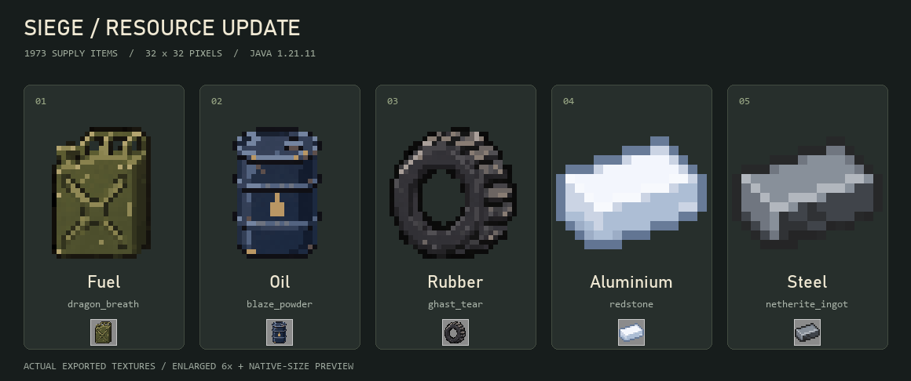

# Siege Resourcepack

Siege Yom Kippur **v1.4.1 Resources** für Minecraft Java Edition **1.21.11**.
Erweitert das bisherige v1.3-Pack um fünf Rohstoffe in Minecraft-Pixeloptik,
inspiriert von militärischen Nachschubmaterialien der 1970er-Jahre.

## Download

[Aktuelles Resourcepack herunterladen](https://raw.githubusercontent.com/Siegemc/Siege-Ressourcepack/main/Siege-Yom-Kippur-1.21.11-v1.4.1-resources.zip)

Die ZIP ist das vollständige Pack und kann direkt installiert werden.
Die bisherige [Version v1.4](https://raw.githubusercontent.com/Siegemc/Siege-Ressourcepack/main/Siege-Yom-Kippur-1.21.11-v1.4-resources.zip)
bleibt als unveränderte Vorgängerversion verfügbar.

## Neue Rohstoffe

| Minecraft-Gegenstand | Anzeigename | Aussehen |
| --- | --- | --- |
| `minecraft:dragon_breath` | Fuel | Olivgrüner Treibstoffkanister mit X-Verstärkung |
| `minecraft:blaze_powder` | Oil | Dunkles Ölfass mit Rippen und Tropfensymbol |
| `minecraft:ghast_tear` | Rubber | Schwarzer Gummireifen mit grobem Profil |
| `minecraft:redstone` | Aluminium | Sauberer, heller silberblauer Minecraft-Barren |
| `minecraft:netherite_ingot` | Steel | Sauberer, dunkelgrauer Minecraft-Barren mit heller Metallkante |



Die Texturen sind 32×32-Pixel-PNGs mit transparentem Hintergrund. Die normalen
Gegenstände erhalten die neuen Modelle ohne `CustomModelData` oder zusätzliche Mods.
Aluminium und Steel orientieren sich an der klassischen Minecraft-Ingot-Form:
große, ruhige Farbflächen ohne Flecken oder Rost. Die Barren verwenden ein
16×16-Pixelraster, das ohne Glättung auf 32×32 Pixel vergrößert wurde.
Seit v1.4.1 bleibt das vollständige Raster erhalten, statt die Kontur auf 14 Pixel
zu stauchen. Beide Barren haben dadurch die pixelgenaue Kontur des Vanilla-Eisenbarrens.
Die Anzeigenamen gelten in Deutsch, Englisch (US) und Englisch (UK).
Minecraft-IDs, Rezepte und Spielmechaniken bleiben bestehen; platziertes Redstone bleibt Redstone.
Serverseitig gesetzte eigene Namen oder `item_model`-Komponenten haben weiterhin Vorrang.

Alle bestehenden Waffen-, Fahrzeug- und übrigen Asset-Dateien bleiben bytegleich erhalten.
Nur die Pack-Beschreibung wird aktualisiert; die Rohstoffdateien kommen neu hinzu.

## Auf einem Minecraft-Server eintragen

Diese beiden Werte in der bestehenden `server.properties` setzen und den Server neu starten:

```properties
resource-pack=https://raw.githubusercontent.com/Siegemc/Siege-Ressourcepack/main/Siege-Yom-Kippur-1.21.11-v1.4.1-resources.zip
resource-pack-sha1=35b77336c9d5a7a76001cb838d177293dc4b5918
```

Die gleichen Werte stehen in `server.properties.example`. Bei einem Hosting-Panel
die URL unter Resource Pack und die Prüfsumme unter Resource Pack SHA-1 eintragen.
Wenn das Pack verpflichtend sein soll, zusätzlich `require-resource-pack=true` setzen.
Bei jeder Änderung der ZIP muss auch die SHA-1-Prüfsumme aktualisiert werden.

## Lokal installieren und prüfen

ZIP herunterladen, in Minecraft unter **Optionen > Ressourcenpakete > Paketordner öffnen**
ablegen und aktivieren. Die ZIP nicht entpacken. Bei mehreren aktiven Packs Siege nach oben setzen.

Für einen Test in einer Welt mit Befehlsrechten:

```mcfunction
/give @s minecraft:dragon_breath
/give @s minecraft:blaze_powder
/give @s minecraft:ghast_tear
/give @s minecraft:redstone
/give @s minecraft:netherite_ingot
```

Inventaransicht, Namen beim Darüberfahren und die Gegenstände in der Hand prüfen.
Bei einem bereits laufenden Client lädt `F3+T` die Ressourcen neu.

## Quelldateien und Neubau

`resource-overrides/` enthält die neuen Item-Definitionen, Modelle, Texturen,
Sprachdateien und `pack.mcmeta`. Die ursprüngliche v1.3-ZIP ist die Basis.
Die Motive wurden mit dem integrierten Imagegen-Werkzeug erstellt und für Minecraft
auf 32×32 Pixel mit harten Alphakanten exportiert.
[Prompts und Exportparameter](docs/texture-prompts.json) liegen im Repository.

Zum Bauen genügt Python 3, ohne zusätzliche Pakete:

```sh
python scripts/build_pack.py
python scripts/build_pack.py --check
```

Der Neubau erzeugt die v1.4.1-ZIP und aktualisiert `SHA1SUMS` sowie
`server.properties.example`. Nach späteren Texturänderungen die Prüfsumme und Größe
in dieser README ebenfalls anpassen.
Die Prüfung kontrolliert ZIP-CRC, alle JSON-Dateien, Item-/Modell-/Texturzuordnungen,
Sprachschlüssel, PNG-Abmessungen, Pack-Format, Server-Prüfsumme und den bytegleichen
Erhalt sämtlicher nicht überschriebener Originaldateien.

## Paketdaten

- Datei: `Siege-Yom-Kippur-1.21.11-v1.4.1-resources.zip`
- Größe: 5.951.581 Bytes
- SHA-1: `35b77336c9d5a7a76001cb838d177293dc4b5918`
- Ressourcenpaket-Format: 75 (Minecraft Java 1.21.11)
- `pack.mcmeta` und `assets/` liegen direkt im ZIP-Hauptverzeichnis.

Format-Referenzen: [Minecraft Java 1.21.11](https://www.minecraft.net/en-us/article/minecraft-java-edition-1-21-11)
und [Item-Definitionen ab Java 1.21.4](https://www.minecraft.net/en-us/article/minecraft-java-edition-1-21-4).
Server-Einstellungen: [PaperMC server.properties](https://docs.papermc.io/paper/reference/server-properties/).
